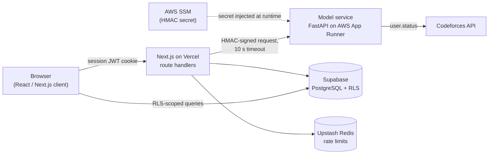

# CP-Dojo

[](https://github.com/Darth-hub/cp-dojo/actions/workflows/ci.yml)

Personalised competitive-programming training for Codeforces users. Pick a rating range and topics and CP-Dojo builds a practice set, or a timed mock contest, biased toward the difficulty band where you actually improve. Live at **[cp-dojo.vercel.app](https://cp-dojo.vercel.app/)**.

## Architecture



| Part | Stack | Responsibility |
|---|---|---|
| Web app (`/`) | Next.js 16, TypeScript, React 19, Tailwind | UI, auth (Codeforces compile-error verification → custom JWT), sessions, contests, statistics |
| Model service (`model-service/`) | Python 3.12, FastAPI, NumPy | Trains the per-user adaptive-difficulty model (logistic regression) from Codeforces history |
| Infrastructure (`infra/`) | Terraform, AWS (ECR, App Runner, SSM, IAM, Budgets) | Everything the model service runs on, plus GitHub OIDC for keyless deploys |
| CI/CD (`.github/workflows/`) | GitHub Actions | Lint, type-check, tests, builds, Terraform validation; deploy on green `main` |

### How a training set is generated
1. The training page calls `POST /api/model`. The route reads the user id from the **signed session JWT** (never from the request body), rate-limits per user, and looks up the user's Codeforces handle and platform rating.
2. Next.js signs a request to the model service with **HMAC-SHA256** over `timestamp.METHOD.path.body`. The service rejects unsigned, tampered, or >5-minute-old requests.
3. The service fetches the user's submissions, labels each rated problem (solved in ≤ 3 attempts = comfortable), computes per-tag solve rates, trains logistic regression and returns the weights. Results are cached for 10 minutes per user.
4. The browser scores candidate problems locally with those weights, ranks them **within the filtered pool**, and does weighted sampling around a target percentile.

**Graceful degradation:** if the model service is slow, down, or not configured, `/api/model` returns `null` and generation falls back to uniform random. The training page never breaks because of it. Contests always use uniform random by design, since a contest should be a fair assessment.

## Running locally

**Everything in Docker:**
```bash
cp .env.example .env          # fill in Supabase/Upstash keys; set MODEL_SERVICE_SECRET (openssl rand -hex 32)
docker compose up --build     # web on :3000, model service on :8080
```

**Or natively:**
```bash
# model service
cd model-service
python -m venv .venv && source .venv/bin/activate
pip install -r requirements-dev.txt
MODEL_SERVICE_SECRET=<same value as in .env> uvicorn app.main:app --port 8080 --reload

# web app (separate terminal, repo root)
npm install
npm run dev
```

## Tests

| Suite | Command | Covers |
|---|---|---|
| Model service | `cd model-service && pytest` | labelling, tag rates, training convergence, cold start; API auth (missing/wrong/tampered/stale signatures), caching, Codeforces error and timeout handling, input validation |
| Web | `npm test` | request signing (shared vector with the Python suite), model-service fallbacks, performance-rating maths |
| Static checks | `npm run lint && npm run typecheck`, `ruff check .`, `terraform validate` | |

The Python port of the training code was checked against the original TypeScript implementation on the same data: weights match to ~1e-17.

## Deploying the model service (first time)

Prerequisites: an AWS account, the AWS CLI logged in, Terraform ≥ 1.6. Region defaults to `ap-south-1` (Mumbai).

```bash
cd infra
cp terraform.tfvars.example terraform.tfvars        # set budget_alert_email
terraform init
terraform apply                                     # 1) ECR, IAM, SSM secret, budget, GitHub OIDC role

# 2) push the first image (App Runner needs one to exist before the service can be created)
ECR=$(terraform output -raw ecr_repository_url)
aws ecr get-login-password | docker login --username AWS --password-stdin "${ECR%%/*}"
docker build -t "$ECR:latest" ../model-service && docker push "$ECR:latest"

terraform apply -var create_service=true            # 3) create the App Runner service
```

Then wire up GitHub and Vercel:

- **GitHub → Settings → Environments:** create `production`.
- **GitHub → Settings → Variables (Actions):** `AWS_REGION`, `AWS_DEPLOY_ROLE_ARN` (`github_deploy_role_arn` output), `ECR_REPOSITORY` (`ecr_repository_name`), `APP_RUNNER_SERVICE_ARN`, `APP_RUNNER_SERVICE_URL` (hostname, from outputs).
- **Vercel → Environment Variables:** `MODEL_SERVICE_URL=https://<app_runner_service_url>` and `MODEL_SERVICE_SECRET` = `aws ssm get-parameter --with-decryption --name /cpdojo/model-service/secret --query Parameter.Value --output text`.

After that, every push to `main` that passes CI builds the image, pushes it to ECR tagged with the commit SHA, deploys it to App Runner, and waits for `/health`.

**Cost:** one 0.25 vCPU / 0.5 GB App Runner instance is a few USD a month. A budget alert fires at 80% forecast / 100% actual of `monthly_budget_usd` (default 5). Pause the service in the App Runner console when you're not using it.

## Design docs
- [`DECISIONS.md`](DECISIONS.md): architecture and data-model decisions, with reasons
- [`TRADEOFFS.md`](TRADEOFFS.md): what was traded away, and why
